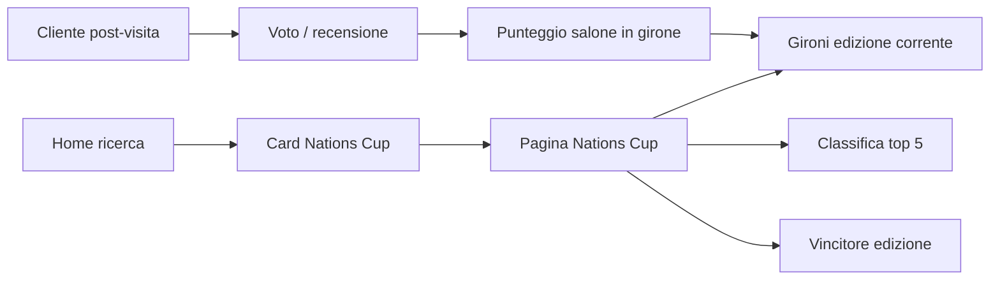

# Nations Cup — Coppa nazionale saloni (bozza prodotto)

> **Stato:** in definizione — card in home ricerca attiva; logica torneo, votazione e classifica **non ancora implementate**.
> Ultimo aggiornamento: 2026-07-13

---

## Visione

**Nations Cup** è una competizione **a livello nazionale** tra i saloni partner su Saloni Luxury (Italia). I **clienti** sono i giudici: il punteggio nasce dalle **recensioni e dai voti** raccolati sulla piattaforma. Alla fine dell’edizione **vince un solo salone**; in parallelo è prevista una **classifica dei primi 5** visibile al pubblico.

Obiettivo prodotto: aumentare engagement B2C, visibilità dei saloni premium e narrativa «campione d’Italia» sulla home di ricerca.

---

## Principi concordati (v1 — da rifinire)

| Aspetto | Decisione attuale |
|--------|-------------------|
| Ambito geografico | Tutti i **saloni d’Italia** eleggibili (premium / criteri da definire) |
| Giudici | **Clienti** (voto tramite recensioni post-visita o meccanismo dedicato — TBD) |
| Categorie UI | Switch **Saloni** / **Operatori** su `/nations-cup` (due classifiche parallele in bozza) |
| Struttura | **Gironi casuali** (sorteggio saloni in gruppi) |
| Esito finale | **Un vincitore** assoluto dell’edizione |
| Classifica pubblica | **Top 5** saloni in evidenza (oltre al vincitore) |
| UI home ricerca | Card **Nations Cup** flottante in **alto a destra** (separata dal blocco ricerca) → `/nations-cup` |
| Click icona / card | Solo teaser **«In arrivo»** — saloni e operatori per scoprire i migliori d'Italia (niente regolamento né classifica placeholder) |

---

## Flusso utente (target)

---

## Aperture da definire (prossimi passi)

1. **Eleggibilità** — solo saloni Premium? Tutte le sedi con almeno N recensioni?
2. **Periodo edizione** — annuale, semestrale, trimestrale?
3. **Sorteggio gironi** — numero gironi, saloni per girone, criteri di bilanciamento (regione, tipologia HAIR/BEAUTY/MASSAGE)?
4. **Punteggio** — media recensioni salone, recensioni nell’edizione, peso voto operatore, anti-frode?
5. **Fasi eliminatorie** — solo girone + finale nazionale, o tabellone a eliminazione diretta?
6. **Premi / badge** — vetrina home, badge su mini-sito `/s/:slug`, notifiche push?
7. **Backend** — nuove entità (`nations_cup_edition`, `nations_cup_group`, `nations_cup_standing`, …) vs derivazione da `reviews` + job periodico.

---

## Implementazione attuale nel repo

| Layer | Stato |
|-------|--------|
| `luxury-frontend` — card home | ✅ Card flottante in alto a destra su `HomePage` (hero ricerca), con icona coppa |
| `luxury-frontend` — `/nations-cup` | ✅ Teaser «In arrivo» (saloni + operatori, migliori d'Italia) |
| `luxury` — API torneo | ❌ Non presente |
| Database | ❌ Non presente |
| Admin / sorteggio gironi | ❌ Non presente |

### File di riferimento frontend

- `luxury-frontend/src/components/NationsCupTrophyIcon.tsx` — icona coppa
- `luxury-frontend/src/pages/NationsCupPage.tsx` — landing pubblica
- `luxury-frontend/src/styles/nations-cup-page.css` — stili pagina

---

## Note legali e comunicazione (bozza)

- Chiarire nei **Termini** / regolamento ufficiale che la Nations Cup è una **promozione Saloni Luxury**, non un campionato sportivo.
- Consentire opt-out salone? (da decidere con legale)
- Trasparenza criteri di voto e periodo di votazione prima del go-live dell’edizione 1.

---

## Collegamenti

- Home ricerca e classifiche correlate: migliori saloni del mese (`monthlyIdea`), migliori operatori (`/operatori/migliori`)
- Recensioni: `Review` + `staff_rating` / `rating` — probabile base del punteggio
- Ruoli: votazione **CLIENT**; vetrina pubblica senza auth

Quando l’implementazione backend partirà, aggiornare anche `.cursor/rules/luxury-project-master.mdc` e la sezione API in questo file.
